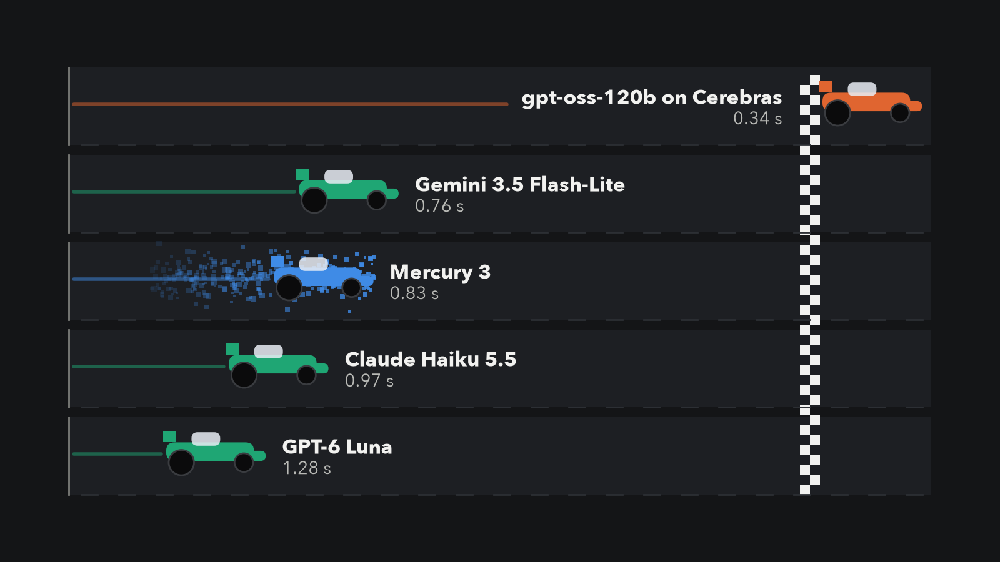
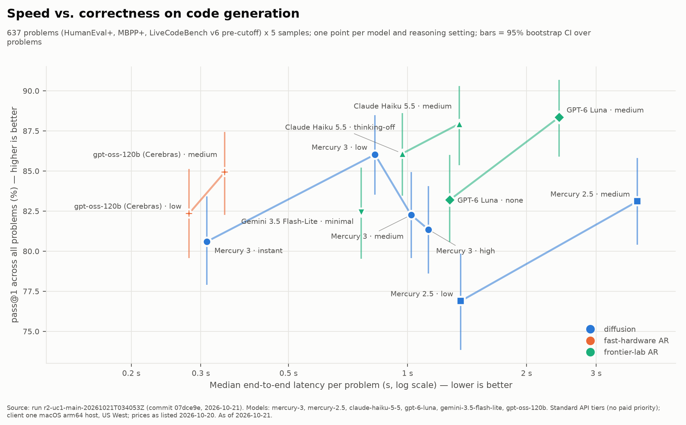

# mercury3: Diffusion vs. autoregressive LLM evaluation

> 📄 **Read the full technical report:** [Mercury 3 vs. the Fast Autoregressive Models](https://zbruceli.org/blog/mercury-3-vs-the-fast-autoregressive-models/): methods, every table and chart, failure analysis, and vendor observations.

A harness for benchmarking Inception Labs **Mercury 3** (a diffusion LLM) against the fast tiers of autoregressive LLMs: Claude Haiku 5.5, GPT-6 Luna, Gemini 3.5 Flash-Lite, and gpt-oss-120b on Cerebras as a fast-hardware control. It covers two use cases:
- **UC1:** code-generation speed and quality (HumanEval+, MBPP+, LiveCodeBench v6; 637 problems × 5 samples).
- **UC2:** latency in a multi-step SQL tool-calling agent (BIRD Mini-Dev; 150 questions × 3 repeats, up to 8 turns).

The results feed a follow-up to *[What is Diffusion LLM and why it matters](https://medium.com/the-low-end-disruptor/what-is-diffusion-llm-and-why-it-matters-749033d1efb1)* (The Low End Disruptor, Feb 2025).

**Status (2026-10-21):** M0–M4 done; M5 blog draft written and fact-checked. Per-feature status: [docs/FEATURES.md](docs/FEATURES.md).

## Is diffusion LLM the speed demon as promised?



*Where each model is when the first one finishes, by median time to answer a coding problem (cars drawn at constant speed). 637 problems × 5 samples, run r2-uc1-main-20261021T034053Z, as of 2026-10-21.*

On October 19, 2026, Inception Labs launched Mercury 3, claiming it beats GPT-6 Luna and Claude Haiku 5.5 on benchmarks while running 4–8× faster, at more than 1,000 tokens per second ([Inception blog](https://www.inceptionlabs.ai/blog/introducing-mercury-3)). This repo tests that claim with about \$56 of API spend and more than 62,000 model calls.

**Short version:** Mercury 3 is genuinely fast and genuinely good. It is not the fastest thing on the menu, it is not the cheapest per right answer, and it has one very odd habit.

### Key findings (as of 2026-10-21)

1. **Speed is real, but not unique.** On code generation, Mercury 3 `low` passes 86.0\% of problems at a 0.83 s median, tying Claude Haiku 5.5 with thinking off (86.1\% at 0.97 s). But the control, gpt-oss-120b on Cerebras, passes 84.9\% at 0.34 s. Mercury 3 decodes ~850–900 visible tokens/s (about 2× Gemini Flash-Lite, 2.8× Claude Haiku, 6× GPT-6 Luna); gpt-oss on Cerebras decodes ~2,400–2,500, about 2.7× faster, at every output length.
2. **In agents, the number of turns matters as much as speed per turn.** In the SQL agent, Mercury 3 `low` finishes a task in 2.05 s at the median, 1.9–2.8× faster than Claude Haiku (3.87 s), Gemini (4.44 s) and GPT-6 Luna (5.69 s), over all 496 usable BIRD questions. Haiku is 3.2× slower per call but only 1.9× slower per task because it needs ~3.2 turns to Mercury's 5.1. gpt-oss on Cerebras is 1.7× faster per call but needs 6.3 turns, ending only slightly faster per task (1.92 s). On accuracy (44.7–57.8\%), Claude Haiku is 4–5 points ahead of Mercury 3 on the same questions, and gpt-oss is 6–8 points behind.
3. **Cheap per token is not cheap per answer.** Mercury 3 `low` costs \$0.59 per 1,000 passing code answers at its 50\%-off launch price (\$1.19 regular); GPT-6 Luna with reasoning off costs \$0.07. In the agent, Mercury 3 `low` costs \$1.38 per 1,000 correct tasks (\$2.77 regular) against Luna's \$0.77; at regular prices Claude Haiku (\$1.55) beats every Mercury setting.
4. **Mercury 3 sometimes thinks forever.** More reasoning makes it worse on code: 86.0\% at `low`, 82.3\% at `medium`, 81.4\% at `high`, because 7.5–8.6\% of calls reason silently until the 32,768-token cap and return nothing. Those calls burned 61\% of Mercury 3's output tokens in the code test. No other model did this even once. Autoregressive models fail by committing; this one fails by not stopping.



*Code generation: accuracy vs median latency, one point per model and setting. Run r2-uc1-main-20261021T034053Z, as of 2026-10-21.*

### Surprises that have nothing to do with diffusion

- **OpenAI has a slow front door.** Even a free "list models" request took 0.8–1.2 s of server-side processing; paying 2× for Fast mode trimmed only ~0.15 s at the median.
- **The cheapest right answer comes from GPT-6 Luna with reasoning off**, the slowest decoder in the test.
- **Some models really like to talk.** Asked for an ~800-line program, Claude Haiku and GPT-6 Luna wrote ~15,000 tokens; gpt-oss wrote ~6,000.
- **Claude Haiku stops exploring when you ask for JSON:** with a strict output schema it answered all 150 database questions in one shot, without looking at the database.
- **Mercury 3 sometimes leaks its own plumbing:** in strict-JSON mode it broke the format on 6 of 150 tasks, mostly by appending internal tool-call markup. Every other model: zero.
- **Cerebras throttled below its published limit:** 765 rate-limit errors in the code test while the client stayed under 1,000 requests per minute.

### Verdict

Mercury 3 is faster than the big labs' fast models, about as accurate as them on code with reasoning off, a few points behind Claude Haiku as an agent, and the fastest of them in agent loops. But an ordinary autoregressive model on Cerebras hardware was faster in both tests, so what this measures is a *product* (model plus serving stack), not an architecture. It's a speed demon, just not the only one in town.

**Caveats:** products, not architectures; LiveCodeBench problems predate the models' training cutoffs (a harder set, not a fresh one); SQL accuracy has ±4 point error bars per model (±2–3 for paired differences); Mercury's prices are promotional and double at the regular price; one client host in the US West, one day, standard API tiers.

Every number has a run id. Details: [M2](docs/M2_UC1_RESULTS.md), [M3](docs/M3_UC2_RESULTS.md), [M4](docs/M4_ANALYSIS_RESULTS.md), [M5 fact-check](docs/M5_BLOG_RESULTS.md). All charts and tables: [reports/](reports/README.md).

## Quick start

```bash
uv sync                                                        # Python 3.12
make check                                                     # lint, types, offline tests (no API calls)
uv run dllm-eval run configs/experiments/r2_uc1_main.yaml --dry-run   # cost estimate only
uv run dllm-eval report                                        # rebuild every chart and table in reports/ from scored runs
```

Live runs need API keys in `.env` (see the variable names in `configs/models.yaml`) and spend real money: always dry-run first. Model-generated code runs only inside a locked-down Docker sandbox. Raw run directories (`results/runs/`) and datasets (`data/`) are not in git; `uv run dllm-eval fetch-data` downloads and checksums the datasets from their official sources.

## Docs

| Doc | Contents |
|---|---|
| [docs/PRD.md](docs/PRD.md) | Requirements, the two use cases, and methodology rules |
| [docs/ROADMAP_AND_PLAN.md](docs/ROADMAP_AND_PLAN.md) | Roadmap and milestone gates, then the implementation plan: stack, layout, interfaces, Mercury API notes |
| [docs/TEST_PLAN.md](docs/TEST_PLAN.md) | Software tests and experiment protocol |
| [docs/FEATURES.md](docs/FEATURES.md) | Prioritised feature list with Done status |
| [docs/BLOG_ALIGNMENT.md](docs/BLOG_ALIGNMENT.md) | How the results map onto the original article |
| [docs/BUDGET_ESTIMATE.md](docs/BUDGET_ESTIMATE.md) | Token and cost estimate for the planned runs (`make budget`) |
| [docs/M0_SMOKE_RESULTS.md](docs/M0_SMOKE_RESULTS.md) | M0: live API smoke results and API findings |
| [docs/M1_SMOKE_RESULTS.md](docs/M1_SMOKE_RESULTS.md) | M1: harness core gate |
| [docs/M2_UC1_RESULTS.md](docs/M2_UC1_RESULTS.md) | M2: UC1 code generation (R1 pilot, R2 main run, R3 length sweep) |
| [docs/M3_UC2_RESULTS.md](docs/M3_UC2_RESULTS.md) | M3: UC2 SQL agent (R4 main run, R4b strict-schema sub-run) |
| [docs/M4_ANALYSIS_RESULTS.md](docs/M4_ANALYSIS_RESULTS.md) | M4: blog assets, failure taxonomy, diffusion replay |
| [docs/M5_BLOG_RESULTS.md](docs/M5_BLOG_RESULTS.md) | M5: blog draft fact-check, every number against its run id |
| [reports/README.md](reports/README.md) | Generated charts, tables, failure gallery, decision matrix |
| [docs/templates/MILESTONE_RESULTS.md](docs/templates/MILESTONE_RESULTS.md) | Template for each milestone's results doc |
| [CLAUDE.md](CLAUDE.md) | Working rules for this repo |

## License

Code: [MIT](LICENSE). Benchmark datasets (HumanEval+, MBPP+, LiveCodeBench, BIRD) are not redistributed here and stay under their owners' licenses; see the sources in [configs/datasets.yaml](configs/datasets.yaml).

## Full technical report

The complete write-up of this study, with methods, all results tables, failure cases, and the claims scorecard: **[Mercury 3 vs. the Fast Autoregressive Models: A Technical Report](https://zbruceli.org/blog/mercury-3-vs-the-fast-autoregressive-models/)**.
