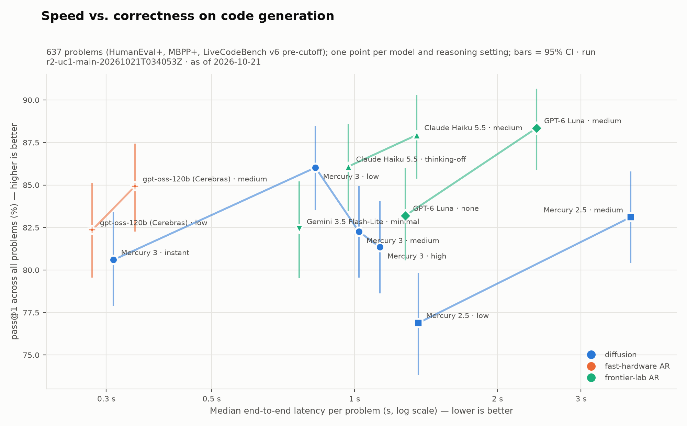

# M2 UC1 code generation results

| | |
|---|---|
| Milestone | M2: UC1 code generation (see [ROADMAP_AND_PLAN.md](ROADMAP_AND_PLAN.md) §1) |
| Date | 2026-10-21 |
| Commit | `446e61b` (the R1 pilot ran on this) |
| Gate verdict | **Passed** (2026-10-21) |
| Tokens / spend | R1: $0.29; R1b cap probe: $0.29; OpenAI Fast-mode test: $0.002; **R2: $23.37**; R3: $2.03 |
| R2 answer | **At matched quality the Cerebras AR control is faster than Mercury 3** (84.9% at 0.35 s vs 86.0% at 0.83 s), and **Mercury 3 gets worse above `low` reasoning** (budget-out on up to 8.6% of calls) (§6) |
| R3 answer | **Decode speed is flat with output length for every model:** Mercury 3 ~850–900 visible tok/s (2–6× the frontier-lab fast models), Cerebras gpt-oss ~2,400–2,500. `realtime` gave no gain (§7) |
| Cap probe answer | **A bigger budget barely helps Mercury 3:** at 131,072 tokens, 1 of 12 failures was rescued (§4) |
| OpenAI latency answer | **Not your usage tier:** OpenAI adds ~0.45–0.6 s server-side per request; paid Fast mode trims ~0.15 s at the median (§5) |

## 1. Gate checklist

The exit gate from ROADMAP_AND_PLAN §1:

| Criterion | Result | Evidence |
|---|---|---|
| Pilot reviewed | ✅ | §3 (pilot), §4 (cap probe), §5 (OpenAI Fast-mode test), §8 (findings) |
| R2 complete | ✅ | §6: 41,405/41,405 ok, 0 harness errors |
| R3 complete | ✅ | §7: 630/630 ok |
| Pareto chart regenerates offline | ✅ | `dllm-eval charts` → [figures/m2_r2_pareto_uc1.png](figures/m2_r2_pareto_uc1.png) |
| CI targets met (PRD UC1) | ✅ | pass@1 ≤ 2.6 pp, median latency ≤ 4.5% (§6.1) |

## 2. Offline verification (before R1)

- `make check`: 169 offline tests pass.
- `make test-sandbox`: **all 542 EvalPlus canonical solutions pass in Docker**. Pinned input drops: HumanEval/32 7 of 888, Mbpp/255 1 of 112. The lockdown checks pass: no network, no DNS, no writes outside `/tmp`.
- All 3,866 LiveCodeBench v6 tests are well formed.
- See [ROADMAP_AND_PLAN §8](ROADMAP_AND_PLAN.md) for the 26 grader gaps the canonical check found and fixed.

## 3. R1 pilot run

| | |
|---|---|
| Run id | `r1-pilot-uc1-20261021T020019Z` (local only) |
| Config | [configs/experiments/r1_pilot_uc1.yaml](../configs/experiments/r1_pilot_uc1.yaml) |
| Workload | 4 HumanEval+, 3 MBPP+, 3 LiveCodeBench v6 (seed 1) × 3 repeats × 13 arms |
| Jobs / result | **390/390 ok**: 0 errors, 0 retries, 0 warnings, no abort |
| Spend | **$0.29** (dry-run expected $0.31) |
| Scoring | 390 responses graded in Docker in 2 minutes. Extraction: 383 fenced, 7 empty |
| Network baseline | Median connect 17–24 ms everywhere. Median TTFB of `GET /models`: Inception 22 ms, Cerebras 102, Google 147, Anthropic 177, **OpenAI 1,816** |

The network probe's first live run worked against all five providers. Its TLS path was the open item from M1.

> 10 problems and 3 samples each: the numbers below show how the pipeline behaves and where the money and time go. They are **not results**; don't quote them.

### 3.1 Per arm

| Arm | TTFT p50 (s) | Total p50 / p95 (s) | Out tok/s p50 | Length stops | Pilot $ |
|---|---:|---:|---:|---:|---:|
| `mercury-3:instant` | 0.250 | 0.26 / 5.9 | 375 | 0 | 0.0104 |
| `mercury-3:low` | 0.524 | 0.53 / 14.4 | 479 | 0 | 0.0141 |
| `mercury-3:medium` | 0.678 | 0.70 / 57.7 | 436 | **3** | 0.0389 |
| `mercury-3:high` | 0.754 | 1.17 / 52.2 | 429 | **4** | 0.0521 |
| `mercury-2.5:low` | 0.991 | 1.19 / 5.5 | 351 | 0 | 0.0138 |
| `mercury-2.5:medium` | 2.939 | 3.05 / 8.7 | 416 | 0 | 0.0334 |
| `claude-haiku-5-5:thinking-off` | 0.554 | 1.06 / 6.6 | 150 | 0 | 0.0049 |
| `claude-haiku-5-5:medium` | 0.710 | 1.23 / 12.8 | 162 | 0 | 0.0083 |
| `gpt-6-luna:none` | 0.988 | 1.87 / 30.5 | 27 | 0 | 0.0026 |
| `gpt-6-luna:medium` | 1.977 | 2.42 / 25.0 | 60 | 0 | 0.0056 |
| `gemini-3.5-flash-lite:minimal` | 0.519 | 0.82 / 13.2 | 188 | 0 | 0.0544 |
| `gpt-oss-120b-cerebras:low` | 0.227 | 0.33 / 2.0 | 912 | 0 | 0.0176 |
| `gpt-oss-120b-cerebras:medium` | 0.269 | 0.33 / 4.6 | 1155 | 0 | 0.0360 |

## 4. R1b output-cap probe: does a bigger budget help Mercury 3?

**Answer: barely.** At 4× the budget (131,072 tokens), 1 of 12 calls that failed at the 32,768 cap was rescued. The rest either converged quickly anyway or kept reasoning to the new cap. Raising the cap mostly makes failures slower and more expensive, so R2 keeps the uniform 32,768 cap. Caveat: this rests on 2 problems and 12 calls; R2 shows how common runaways are overall.

| | |
|---|---|
| Run id | `r1b-cap-probe-20261021T021543Z` (local only), commit `8e1d87f` |
| Config | [configs/experiments/r1b_cap_probe.yaml](../configs/experiments/r1b_cap_probe.yaml) |
| Workload | The two R1 budget-out problems × Mercury 3 `medium` and `high` × 3 samples, at a **131,072**-token cap (Mercury 3's maximum) |
| Jobs / result | 12/12 ok, $0.29 |

| Call | Stop | Output tokens (all reasoning unless noted) | Time (s) | Result |
|---|---|---:|---:|---|
| HumanEval/146 `medium` ×3 | stop | 711 / 1,109 / 1,192 | 1.3–2.4 | pass ×3 |
| HumanEval/146 `high` | stop, stop, **length** | 1,317 / 1,381 / **129,390** | 2.6 / 2.7 / **83.7** | pass, pass, budget out |
| abc388_d `medium` ×3 | **length** ×3 | 128,982 / 129,565 / 128,982 | 191–207 | budget out ×3 |
| abc388_d `high` | length, **stop**, length | 130,271 / **36,515** / 129,565 | 184 / **61** / 229 | budget out, **pass**, budget out |

**Detail:** quadrupling the budget rescued **1 of 12** calls (abc388_d `high`, which converged at 36,515 tokens, just above the 32,768 cap). Everything else either converged quickly anyway (HumanEval/146, ~1k tokens) or kept reasoning to the new cap (abc388_d, 3–4 minutes each). So Mercury 3's budget-out is mostly **non-converging reasoning on hard problems**, not a cap that's too tight. This supports keeping the uniform 32,768 cap.

One oddity: several runaways stopped at identical token counts (128,982 twice, 129,565 twice). It's recorded as an observation, with no explanation claimed.

## 5. Side test: GPT-6 Luna standard vs Fast mode (M2-F3)

**Question:** is Luna's slow first token caused by your new OpenAI account's usage tier or queueing, or is it fixed overhead at OpenAI's API front door?

**Answer: mostly fixed overhead, not your tier.**
- OpenAI documents usage tiers (Free / Build / Launch / Grow, set by total credit purchases) as changing **rate limits and monthly caps only, not latency** ([rate-limits guide](https://developers.openai.com/api/docs/guides/rate-limits)). The pilot hit no 429s.
- Paying for **Fast mode** (`service_tier: "fast"`, alias `"priority"`, at 2× the price) trims the median TTFT by about 0.15 s and mainly fixes the slow tail.
- Even with Fast mode, OpenAI spends about **450 ms server-side** before the first token. That's well above Mercury 3 `instant` (0.25 s) and the Cerebras control (0.23 s) in the pilot.

| | |
|---|---|
| Script | [scripts/oai_priority_ab.py](../scripts/oai_priority_ab.py), committed together with this section |
| Raw rows | `results/analysis/oai-priority-ab-20261021T033428Z/calls.jsonl` (local only) |
| Design | 20 short coding prompts, `reasoning_effort: none`, 512-token cap, streamed. Each prompt ran once per tier, in seeded random order, one call at a time |
| Cost | **$0.0022** (40 calls) |
| Served tier | Every response reported the tier requested: no silent fallback |

| Tier | TTFT p50 (s) | TTFT p90 (s) | Worst TTFT (s) | Server `openai-processing-ms` p50 | Total p50 (s) |
|---|---:|---:|---:|---:|---:|
| `default` (standard) | 0.825 | 1.522 | 6.85 | 596 | 1.402 |
| `fast` (2× price) | 0.668 | 0.889 | 1.80 | 450 | 0.967 |

**Paired by prompt:** Fast was quicker on 13 of 20 prompts, with a median gain of 0.146 s. So Fast mode helps, but the effect at the median is modest and noisy; the big change is in the tail (worst case 6.85 s → 1.80 s).

**Context:**
- The free `GET /v1/models` call measured shortly before showed 814–1,209 ms of server processing, with a ~20 ms connect and ~40 ms TLS through Cloudflare's San Jose edge. So the slowness is server-side, not the network.
- The pilot's Luna TTFT (0.99 s median with reasoning off) is in line with the standard tier here; time of day varies.

**Implication for the study:** keep `default` for Luna, as for every model (PRD R1: no provider gets a paid speed tier the others lack). Report Luna's latency next to the network baseline and mention that Fast mode exists. One more factor I can't rule out: account age or undocumented per-account routing. Re-probing in R2 and later runs will show whether the gateway overhead shrinks as the account ages.

## 6. R2 main run

**Answer: at matched quality, the fast-hardware autoregressive control is faster than Mercury 3, and Mercury 3 gets *worse* above `low` reasoning.**
- **Mercury 3's best setting (`low`) reaches 86.0% pass@1 at 0.83 s median.** That ties Claude Haiku 5.5 with thinking off (86.1%, 0.97 s).
- **gpt-oss-120b on Cerebras gets within about a point (84.9%) in 0.35 s.**
- **Above `low`, Mercury 3 runs out of budget on 7.5–8.6% of calls,** which drags `medium` and `high` below `low`.

| | |
|---|---|
| Run id | `r2-uc1-main-20261021T034053Z` (local only), commit `446e61b`, resumed on `48b35cc` |
| Config | [configs/experiments/r2_uc1_main.yaml](../configs/experiments/r2_uc1_main.yaml): all 164 HumanEval+, 378 MBPP+, 95 LiveCodeBench v6 easy+medium (pre-cutoff) × 5 repeats × 13 arms |
| Jobs / result | **41,405/41,405 ok**, 0 errors at the end, no abort. 5 Cerebras 429s failed after retries on the first pass and succeeded on resume |
| Spend | **$23.37** (pilot projection ~$22; budget $80) |
| Scoring | 41,405 answers graded in Docker, **0 harness errors** |
| Wall time | 03:40–07:09 UTC, including a stop/resume and an 18-minute machine sleep |

Figure data: [figures/m2_r2_pareto_uc1.csv](figures/m2_r2_pareto_uc1.csv). Regenerate with `dllm-eval charts r2-uc1-main-20261021T034053Z`.

### 6.1 All arms, ranked by pass@1

pass@1 is over all 637 problems (mean of per-problem pass rates), with a bootstrap 95% CI over problems. Latency is end-to-end per call and excludes warm-up, retried, and pause-spanning calls (§6.3). Cost is per 1,000 solved problems; Mercury is shown at the promo / regular price.

| Arm | pass@1 | Latency p50 / p95 | Budget-out | $ / 1k solved |
|---|---:|---:|---:|---:|
| GPT-6 Luna `medium` | **88.4%** (85.9–90.7) | 2.42 / 10.6 s | 0% | 0.19 |
| Claude Haiku 5.5 `medium` | 87.9% (85.4–90.3) | 1.35 / 6.3 s | 0% | 0.26 |
| Claude Haiku 5.5 thinking off | 86.1% (83.5–88.6) | 0.97 / 3.4 s | 0% | 0.14 |
| **Mercury 3 `low`** | **86.0%** (83.5–88.5) | **0.83** / 10.4 s | 1.4% | 0.59 / 1.19 |
| **gpt-oss-120b (Cerebras) `medium`** | 84.9% (82.3–87.4) | **0.35** / 1.7 s | 0% | 0.78 |
| GPT-6 Luna `none` | 83.2% (80.6–86.0) | 1.28 / 9.9 s | 0% | **0.07** |
| Mercury 2.5 `medium` | 83.1% (80.4–85.8) | 3.82 / 9.4 s | 0% | 1.34 |
| Gemini 3.5 Flash-Lite `minimal` | 82.4% (79.5–85.2) | 0.76 / 2.0 s | 0% | 1.03 |
| gpt-oss-120b (Cerebras) `low` | 82.4% (79.6–85.1) | **0.28** / 1.1 s | 0% | 0.49 |
| Mercury 3 `medium` | 82.3% (79.6–84.9) | 1.02 / **51.9 s** | **7.5%** | 1.59 / 3.18 |
| Mercury 3 `high` | 81.4% (78.6–84.0) | 1.13 / **53.6 s** | **8.6%** | 1.75 / 3.50 |
| Mercury 3 `instant` | 80.6% (77.9–83.4) | 0.31 / 0.85 s | 0.3% | 0.17 / 0.34 |
| Mercury 2.5 `low` | 76.9% (73.9–79.8) | 1.36 / 3.2 s | 0% | 0.45 |

**Precision (PRD UC1 targets): met.** The pass@1 CI half-width is ≤ 2.6 points everywhere (target ≤ 3). Bootstrapped, the CI half-width of median latency is ≤ 4.5% (target ≤ 10%; widest is Mercury 3 `high`).

### 6.2 Per dataset (pass@1)

| Arm | HumanEval+ | MBPP+ | LiveCodeBench v6 |
|---|---:|---:|---:|
| Mercury 3 `instant` / `low` / `medium` / `high` | 88.9 / 92.4 / 90.4 / 88.4 | 77.3 / 81.9 / 82.5 / 82.1 | 79.4 / **91.4** / 67.4 / 66.1 |
| Mercury 2.5 `low` / `medium` | 89.6 / 93.3 | 74.8 / 81.0 | 63.2 / 74.1 |
| Claude Haiku 5.5 off / `medium` | 91.5 / 94.0 | 83.8 / 84.7 | 86.1 / 90.5 |
| GPT-6 Luna `none` / `medium` | 90.2 / 94.0 | 80.4 / 84.3 | 82.1 / 94.5 |
| Gemini 3.5 Flash-Lite `minimal` | 92.2 | 79.0 | 79.2 |
| gpt-oss-120b (Cerebras) `low` / `medium` | 91.8 / 92.8 | 79.1 / 81.2 | 78.9 / 86.3 |

The `medium`/`high` drop is concentrated on LiveCodeBench: Mercury 3 `high` ran out of budget on 155 of 475 calls, but only **6** of its LiveCodeBench answers were actually wrong. When it answers, it is nearly always right; it often doesn't answer.

### 6.3 Data handling during the run

- **Mid-run rate-limit change.** For the first ~50 minutes our client-side limiter held Mercury at the free tier's 100k output tok/min, though the account is pay-as-you-go (300k). After fixing `models.yaml` (`48b35cc`), stopping, and resuming, Mercury reached ~228k tok/min, now bound by concurrency 8. Throughput only: the limiter waits before each request's timer starts.
- **Pauses.** Three gaps over 60 s between call starts:
  - 9.5 min: the stop/resume.
  - 1.1 min: a stall right after resume.
  - 18.1 min: machine sleep.

  17 calls were in flight across a gap; they keep their correctness result but are excluded from latency (`analysis/load.py`, `PAUSE_GAP_S`).
- **Retries.** 921 calls needed retries, 765 of them Cerebras 429s, even though our client stayed under its documented 1,000 RPM. Retried calls are excluded from latency stats, which leaves ~2,800 of 3,185 Cerebras calls per arm; Cerebras's latency is measured on the calls that weren't throttled.

## 7. R3 output-length sweep

**Answer: decode speed is flat with output length for every model, so diffusion has no length-dependent advantage here.**
- **Mercury 3 decodes visible text at about 850–900 tok/s:** about 2× Gemini Flash-Lite, 2.8× Claude Haiku, and 6× GPT-6 Luna.
- **gpt-oss-120b on Cerebras decodes at about 2,400–2,500 tok/s,** about 2.7× Mercury 3, at every length.
- **Mercury's `realtime` flag gave no measurable gain.**

| | |
|---|---|
| Run id | `r3-uc1-length-20261021T152238Z` (local only), commit `b9d80e6` |
| Config | [configs/experiments/r3_uc1_length.yaml](../configs/experiments/r3_uc1_length.yaml): 30 timing-only prompts (10 each asking for ~256 / ~2,000 / ~8,000 output tokens) × 3 repeats × 7 arms (lowest setting per model, plus Mercury 3 `low` and `low` + `realtime`), 16,384-token cap |
| Jobs / result | **630/630 ok**, 0 errors, 0 retries; 7 warm-up and 6 pause-spanning calls excluded from latency |
| Spend | **$2.03** (expected ~$1.67) |

Rates are medians per bucket:
- **End-to-end** = all generated tokens (including hidden reasoning) ÷ total time.
- **Visible decode** = visible tokens ÷ time after the first visible token.

| Arm | Short: TTFT / total | Medium: TTFT / total / visible tok/s | Long: TTFT / total / visible tok/s | Long visible tokens |
|---|---|---|---|---:|
| gpt-oss-120b (Cerebras) `low` | 0.19 / 0.29 s | 0.22 / 1.24 s / **2,471** | 0.23 / 2.71 s / **2,396** | 6,136 |
| **Mercury 3 `instant`** | **0.29 / 0.30 s** | 0.45 / 3.58 s / **902** | 0.46 / 13.5 s / **893** | 10,522 |
| Mercury 3 `low` | 0.57 / 0.58 s | 2.31 / 4.99 s / 880 | 2.54 / 14.5 s / 849 | 8,813 |
| Mercury 3 `low` + `realtime` | 0.62 / 0.62 s | 2.18 / 4.75 s / 905 | 2.76 / 13.9 s / 866 | 9,167 |
| Gemini 3.5 Flash-Lite `minimal` | 0.75 / 0.95 s | 0.68 / 6.54 s / 444 | 0.73 / 19.3 s / 438 | 8,214 |
| Claude Haiku 5.5 thinking off | 0.58 / 0.93 s | 0.63 / 13.9 s / 323 | 0.54 / 46.0 s / 324 | 14,530 |
| GPT-6 Luna `none` | 0.91 / 1.69 s | 0.81 / 17.2 s / 164 | 0.84 / 114 s / 132 | 15,017 |

**What the sweep shows:**
- **Flat decode rates.** Every model's visible decode rate is nearly the same for ~2k and ~8–15k-token answers. Diffusion's block decoding doesn't pull further ahead on long outputs; it's a constant-factor speed-up.
- **Short answers arrive in one block.** For Mercury 3 `instant`, total time (0.30 s) ≈ TTFT (0.29 s): the whole ~93-token answer lands at once. That's the visible signature of block decoding, and on short answers TTFT is the whole story.
- **Hidden reasoning delays the first token.** At `low`, Mercury 3's TTFT grows with the task (0.57 → 2.3 → 2.5 s) because it reasons before the first visible block (median ~740–940 reasoning tokens on medium/long prompts). At `instant`, TTFT stays at 0.3–0.5 s.
- **`realtime` didn't help (PRD OQ3).** Its TTFT was within noise of plain `low` (0.62 vs 0.57 s short, 2.18 vs 2.31 s medium, 2.76 vs 2.54 s long), and decode was the same. It may matter for voice-style workloads; for code it doesn't.
- **Verbosity differs a lot, so total time isn't comparable across models.** Asked for ~800 lines, Haiku and Luna wrote ~15k tokens, Mercury ~9–10k, and gpt-oss ~6k. Compare the tok/s columns, not total seconds.
- **All 27 length stops are verbosity, not runaways.** All were on long prompts at the 16,384 cap: Luna 13, Mercury 14 (Mercury `low`'s reasoning stayed at a median of ~1.1k tokens). This differs from R2's budget-out, which was hidden reasoning that never converged.

## 8. Findings

| # | Finding | Impact | Where handled |
|---|---|---|---|
| M2-F1 | **Mercury 3 sometimes reasons until it hits the output cap.** 7 calls (3 at `medium`, 4 at `high`) spent the whole 32,768-token budget on hidden reasoning and returned no answer (`finish=length`, 0 characters). 6 of them were LiveCodeBench `abc388_d` (every medium and high sample) and 1 was HumanEval/146. Its median latency stays low (0.70 s / 1.17 s), but these calls set its p95 at 52–58 s (worst 76 s). No other arm hit the cap | Lowers Mercury's pass@1 at the efforts meant to be most accurate, and dominates its tail latency. Mercury's own defaults are higher (65,536 at medium, 131,072 at high), but the R1b probe (§4) shows that 4× the room rescues only 1 of 12 calls | Scoring reports `budget out` separately from `no code`; both still fail. **Decided: keep the uniform 32,768 cap and report budget-out as a failure mode (§10).** A candidate blog point: a failure mode specific to reasoning effort |
| M2-F2 | **The fast-hardware AR control is the fastest arm here.** gpt-oss-120b on Cerebras: 0.23 s TTFT and 912–1,155 output tok/s at the median, against Mercury 3's 0.25–0.75 s and 375–479 tok/s | If R2/R3 confirm it, speed comes from serving hardware, not architecture: exactly the PRD R13 question | **Confirmed at full scale in R2 (§6):** gpt-oss `medium` 84.9% at 0.35 s vs Mercury 3 `low` 86.0% at 0.83 s, and ~2.5× the throughput. R3 tests longer outputs |
| M2-F3 | **OpenAI is slow at the network/gateway level.** `GET /models` TTFB was 1.8 s (others 22–177 ms), and one Luna call took 120 s | Part of Luna's latency is OpenAI's API front door, not the model | **Side test (§5): mostly fixed overhead, not the usage tier.** Fast mode trims TTFT p50 by ~0.15 s and fixes the tail, but ~450 ms server time remains. Keep `default` (PRD R1); report Luna next to the network baseline |
| M2-F4 | **Extraction is clean.** 383 of 390 responses were fenced; the 7 empty ones are exactly the budget-out calls. All 17 real failures had extracted code and ran: 15 on `abc388_d` and 2 on Mbpp/84 | No grader or extraction problems found | Hardened anyway for R2: stdin extraction now prefers a block that reads input or prints. 0 pilot results changed |
| M2-F5 | **Medians are below the token guesses, but rare runaways dominate the means.** Pilot spend was $0.29 against $0.31 expected | Cost depends on how often runaways happen, so R2 cost is uncertain | BUDGET_ESTIMATE §8 recalibrated from the pilot. R2 actual: $23.37 (§8) |
| M2-F6 | **Mercury 3 gets worse above `low` reasoning.** pass@1 86.0% (`low`) → 82.3% (`medium`) → 81.4% (`high`), because budget-out rises from 1.4% to 7.5% to 8.6% of calls. On LiveCodeBench, `high` ran out of budget on 155 of 475 calls but answered only 6 wrong. Runaway calls consumed **61% of all Mercury 3 output tokens** in R2. At `instant` the same failure appears as visible think-aloud text (17 calls) | The best Mercury 3 setting for code is `low`. Higher effort costs more and is slower (p95 ≈ 52 s) for lower accuracy. A strong, specific blog point | Reported as budget-out (PRD R1). Blog: frame as a reasoning-effort failure mode, not a general accuracy gap |
| M2-F7 | **Mercury 3 is a large step up from Mercury 2.5.** At `low`: 86.0% vs 76.9% pass@1 (+9.1 points) and 0.83 s vs 1.36 s median | Generation-over-generation progress for the "what changed since 2025" section | Lineage chart (M4) |
| M2-F8 | **Speed-ups are constant factors, flat with output length (R3).** Visible decode: Cerebras gpt-oss ~2,400–2,500 tok/s, Mercury 3 ~850–900, Gemini ~440, Haiku ~320, Luna ~130–160, with each model's rate nearly unchanged from ~2k to ~10k+ tokens | Diffusion's advantage over frontier-lab fast models is real (2–6×) but doesn't grow with length; the fast-hardware AR control is ~2.7× Mercury at every length | Blog: "a constant-factor speed-up, and hardware can match or beat it" |
| M2-F9 | **Mercury's `realtime` flag gave no measurable gain for code (PRD OQ3).** TTFT within noise of plain `low` in all three buckets | Not worth a separate arm in UC2 | PRD OQ3 resolved |
| M2-F10 | **Short Mercury answers arrive in a single block.** Total ≈ TTFT (0.30 vs 0.29 s at `instant`) | The visible signature of block decoding: for short outputs, TTFT is the whole latency | Blog "how it feels" section; pairs with the diffusing-mode GIF (M4) |

## 9. R2 cost: projection vs actual (BUDGET_ESTIMATE §8)

Projected from the pilot's mean cost per call, scaled to R2 (2,710 EvalPlus and 475 LiveCodeBench calls per arm):
- **Total: about $21.70**, against an $80 budget and a $50 dry-run estimate.
- **Paid baselines: about $9.30.**
- **Mercury: about 31M tokens**, 31% of the free credit.

The pilot sampled only 3 LiveCodeBench problems, one of which (`abc388_d`) caused every runaway, so this projection is rough in both directions. The `budget_usd` guard stays at $80.

**Actual R2:** $23.37 in total.
- Paid baselines: $7.96 (projected $9.30).
- Mercury: $15.41 at promo prices, covered by the free credit.
- Mercury tokens: **39.6M** (36.0M output), above the projected 31M because runaways were more common at full scale than in the pilot. That's 40% of the 100M free credit for R2 alone.

## 10. Open items

- **Output-cap policy (M2-F1): decided 2026-10-21.** R2 keeps the uniform 32,768 cap (PRD R1), and "budget out" is reported as its own failure mode. The R1b probe (§4) confirmed it: 131,072 rescued 1 of 12 calls.
- Chart polish for the blog (M4): a few labels touch neighbouring error bars in the R2 Pareto chart.

## 11. Where the evidence lives

| What | Where | In git? |
|---|---|---|
| This write-up | `docs/M2_UC1_RESULTS.md` | ✅ |
| R1 raw run | `results/runs/r1-pilot-uc1-20261021T020019Z/` | ❌ local only |
| R3 raw run + analysis | `results/runs/r3-uc1-length-20261021T152238Z/`, `results/analysis/r3-uc1-length-20261021T152238Z/` | ❌ local only (regenerate with `analyze`) |
| R2 raw run | `results/runs/r2-uc1-main-20261021T034053Z/` (`calls.jsonl` 41,405 + resume records, `probes.jsonl`) | ❌ local only |
| R2 scores + analysis | `results/analysis/r2-uc1-main-20261021T034053Z/` (`scores.jsonl`, `calls.parquet`, chart) | ❌ local only (regenerate with `score` / `analyze` / `charts`) |
| R2 Pareto chart + data | `docs/figures/m2_r2_pareto_uc1.png`, `.csv` | ✅ |
| R1b raw run + scores | `results/runs/r1b-cap-probe-20261021T021543Z/`, `results/analysis/r1b-cap-probe-20261021T021543Z/` | ❌ local only |
| OpenAI Fast-mode test rows | `results/analysis/oai-priority-ab-20261021T033428Z/calls.jsonl` | ❌ local only (rerun: `scripts/oai_priority_ab.py`) |
| R1 scores + analysis | `results/analysis/r1-pilot-uc1-20261021T020019Z/` (`scores.jsonl`, `calls.parquet`) | ❌ local only (regenerate with `score` / `analyze`) |
