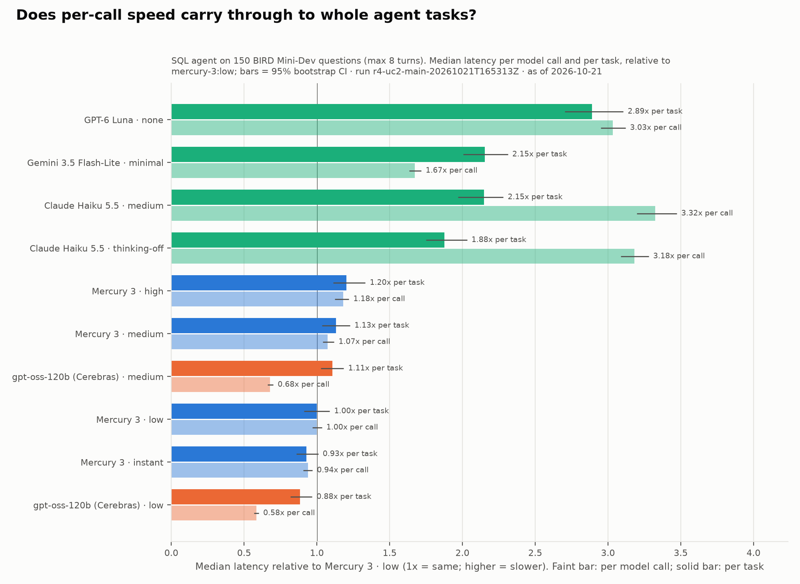

# M3 UC2 SQL agent results

| | |
|---|---|
| Milestone | M3: UC2 multi-step SQL tool-calling agent (see [ROADMAP_AND_PLAN.md](ROADMAP_AND_PLAN.md) §1) |
| Date | 2026-10-21 |
| Commit | `135fef6` (UC2 pilots); `91c7204` (R4); R4 resumed and R4b ran on `3c4b5fc` (§6.3) |
| Gate verdict | **Passed with open items** (§9) |
| Tokens / spend | Aborted pilot: $0.24; UC2 pilot: $0.45; strict pilot: $0.04; **R4: $6.42** ($7.85 at Mercury's regular price); R4b: $0.61. Mercury 3 used **18.3M tokens** in R4 |
| R4 answer | **Mercury 3's per-call speed mostly carries through to whole tasks, but turn count matters as much as per-call speed.** Mercury 3 `low` finishes a task in 2.06 s at the median. That is 1.9–2.9× faster than the frontier-lab fast models, and about even with gpt-oss-120b on Cerebras, which is 1.7× faster per call but needs more turns (§6) |
| Accuracy | All arms land within a few points: EX 47.6–59.1% with ±7–8 point CIs. Claude Haiku 5.5 is the only arm clearly ahead of Mercury 3 `low` (+4.7 points paired, CI +0.2 to +9.1) |

## 1. Gate checklist

The exit gate from ROADMAP_AND_PLAN §1:

| Criterion | Result | Evidence |
|---|---|---|
| R4 complete | ✅ | §6: 4,500/4,500 tasks ok after one resume; R4b 600/600 |
| Traces replayable | ✅ | `dllm-eval trace <run> --verify --all`: R4 4,499/4,500 match byte for byte (the one miss used `julianday('now')`, §6.4); R4b 600/600; pilot 300/300 |
| Reliability table produced | ✅ | §6.2, from `dllm-eval score r4-uc2-main-20261021T165313Z` |
| Speed-up chart (F6.4, UC2 part) | ✅ | `dllm-eval charts` → [figures/m3_r4_speedup_uc2.png](figures/m3_r4_speedup_uc2.png) |
| CI targets (TEST_PLAN B4: ≤ 3 pp EX, ≤ 10% p50 latency) | 🟡 | Latency met (task p50 CI ≤ ±8.9%). EX not met: ±7–8 points per arm, ±4–6 paired (§6.1, §9) |

## 2. Offline verification

- `make check`: **246 offline tests pass** (was 169 at the end of M2), 94% coverage. The UC2 modules are at 88–100%.
  - Read-only enforcement: writes, ATTACH, and `PRAGMA query_only = OFF` are refused. Timeouts, row caps, and multi-statement SQL are covered.
  - Tool-call validity: unknown tool, invalid JSON, and schema violations.
  - EX scorer: order, duplicates, NULL, float, and top-level ORDER BY detection.
  - Agent loop: every outcome, using the fake provider's scripted multi-turn mode.
  - Runner end to end, resume, scoring, analysis, chart, trace replay, and the CLI.
  - Archive extraction, including a path-traversal member.
- `make test-bird` (real data, no API calls): 498 unique questions. **All 150 sampled gold queries return rows and score EX = 1 against themselves**; 38 are order-sensitive.
- Gold-query check on all 498 questions: 496 run in ≤ 2.1 s. `bird/518` and `bird/701` don't finish in 60 s, so they are excluded from sampling (`datasets.GOLD_EXCLUDED`).

## 3. Data

| | |
|---|---|
| Dataset | BIRD Mini-Dev, SQLite. `minidev.zip` from the official link in bird-bench/mini_dev, 800,943,648 bytes, sha256 `cc48ba16…92f`, pinned in [configs/datasets.yaml](../configs/datasets.yaml). Downloaded with the user's approval |
| Questions | 500 rows. question_id 137 and 138 are listed twice, verbatim, which leaves **498 unique questions** (M3-F8) |
| R4 sample | [configs/uc2/bird_r4_150.txt](../configs/uc2/bird_r4_150.txt): 45 simple, 75 moderate, 30 challenging (proportional, seed 2026) |
| Pilot sample | [configs/uc2/bird_pilot_10.txt](../configs/uc2/bird_pilot_10.txt): 3 / 5 / 2, drawn from the 150 |

## 4. Pilot (TEST_PLAN B2)

### 4.1 First attempt, aborted

| | |
|---|---|
| Run id | `r1-pilot-uc2-20261021T161833Z` (local only), commit `3866d0a` |
| Result | Stopped by hand at 148 of 330 tasks; spent $0.24 |

The pilot did its job: it found two problems before R4.
- **Gemini's parallel tool calls were merged (harness bug, M3-F1).** The OpenAI-compatible stream assembler joined two calls into `describe_tabledescribe_table` with arguments `{"name":"bond"}{"name":"molecule"}`. Gemini then refused the corrupted history with a 400. Fixed in `135fef6`, with a regression test.
- **GPT-6 Luna can't call tools with reasoning on (M3-F2).** All 13 `gpt-6-luna:medium` tasks got a 400 from OpenAI, which said function tools with `reasoning_effort` aren't supported on `/v1/chat/completions` and to use `/v1/responses` or set the effort to `none`. **Decided with the user: drop the arm** rather than add a Responses-API adapter. `models.yaml` records `tools_reasoning_efforts: [none]`, and both the experiment check and provider validation enforce it.

### 4.2 UC2 pilot

| | |
|---|---|
| Run id | `r1-pilot-uc2-20261021T162056Z` (local only), commit `135fef6` |
| Config | [configs/experiments/r1_pilot_uc2.yaml](../configs/experiments/r1_pilot_uc2.yaml): 10 questions × 3 repeats × 10 arms |
| Jobs / result | **300/300 ok**: 0 errors, 0 warnings; 1,712 tool calls, all valid |
| Spend | **$0.45** (dry-run expected $1.18) |
| Network baseline | Connect 12–15 ms everywhere. `GET /models` TTFB: Inception 14 ms, Cerebras 112, Anthropic 175, Google 207, **OpenAI 837** |
| Trace replay | 300/300 match |

**Audit.** Three questions failed for every arm (`bird/186`, `402`, `347`). They are BIRD label problems, not scorer bugs (M3-F7):
- `bird/186`: the gold query joins through `district`, an odd path that gives 52.63% where the direct join gives 52.13%.
- `bird/402`: the question says "list them by their ID", but the gold query returns only the percentage.
- `bird/347`: the gold query uses an inner join, while most models used a left join.

Our EX and the official BIRD rule agree on all three. Everything else looked as designed. **Sizing:** scaled ×15, the pilot projected R4 at ~$6.8 and ~19M Mercury tokens (BUDGET_ESTIMATE §8.2).

### 4.3 Strict-schema pilot

`r1-pilot-uc2-strict-20261021T163232Z` (commit `135fef6`): 40/40 ok, $0.04. It surfaced M3-F5: Claude Haiku answers in a single turn, without calling any tools, when a JSON schema is set.

## 5. Design notes that matter for reading the numbers

- **One fixed loop for every model.** Same system prompt (`uc2-v1`, frozen), tools, 8-turn cap, and 32,768-token cap per turn. Temperature is 0.5 where accepted. BIRD's evidence is passed as a "Hint", the standard BIRD setting.
- **EX** (primary) compares row multisets. It compares ordered lists only when the gold query has a top-level ORDER BY, and floats are rounded to 6 decimals. **EX (BIRD rule)** is the official `set(pred) == set(gold)`. The two differ by at most 2 points per arm.
- **Task latency** is wall time from the first request to the final answer, including local SQL. Local SQL is tiny: median tool time per task is 7–16 ms, so the task ratio is model time plus turn count. **Call latency** is per model request over the same latency-eligible tasks.
- **The Haiku and Gemini cache columns aren't comparable.** Anthropic caches only with explicit `cache_control`, which we don't send (BUDGET_ESTIMATE §6), so Haiku's cache hit is 0%. Gemini's compat layer doesn't report cached tokens, so its column shows "—".

## 6. R4 main run

| | |
|---|---|
| Run id | `r4-uc2-main-20261021T165313Z` (local only). Started on `91c7204` (same harness as `135fef6`; only R4 budget and chart text changed), resumed on `3c4b5fc` |
| Config | [configs/experiments/r4_uc2_main.yaml](../configs/experiments/r4_uc2_main.yaml): 150 questions × 3 repeats × 10 arms (UC1 arms minus Mercury 2.5 and Luna `medium`) |
| Jobs / result | **4,500/4,500 ok** after one resume (§6.3) |
| Spend | **$6.42** (promo); $7.85 with Mercury at its regular price. Pilot projection: ~$6.8; guard: $20 |
| Mercury tokens | 18.3M (1.9M output), about 18% of the free credit |
| Wall time | 16:53–17:05 UTC, plus a 9-task resume at 17:08 |
| Network baseline | Start / periodic / resume probes, connect 12–35 ms. TTFB: Inception 15–16 ms, Cerebras 99–159, Google 128–208, Anthropic 164–224, **OpenAI 818–846** |

Figure data: [figures/m3_r4_speedup_uc2.csv](figures/m3_r4_speedup_uc2.csv). Regenerate with `dllm-eval charts r4-uc2-main-20261021T165313Z`.

### 6.1 Accuracy, latency, cost

EX is the mean over 150 questions of each question's pass rate across 3 repeats, with a bootstrap 95% CI over questions. The paired difference is against Mercury 3 `low` on the same questions. Latency is the median over latency-eligible tasks. Mercury cost is shown at promo / regular price.

| Arm | EX (95% CI) | Paired Δ vs Mercury `low` | Turns | Task p50 / p95 | Call p50 | $ / correct |
|---|---:|---:|---:|---:|---:|---:|
| Claude Haiku 5.5 `medium` | **59.1%** (51.1–67.3) | +4.9 (−0.7, +10.7) | 3.4 | 4.42 / 9.40 s | 1.25 s | 0.00173 |
| Claude Haiku 5.5 thinking off | 58.9% (51.1–66.0) | **+4.7 (+0.2, +9.1)** | 3.2 | 3.86 / 7.81 s | 1.19 s | 0.00151 |
| Mercury 3 `instant` | 55.6% (48.2–62.2) | +1.3 (−2.7, +5.6) | 5.4 | **1.91** / 6.57 s | 0.35 s | 0.00131 / 0.00262 |
| **Mercury 3 `low`** | 54.2% (46.7–61.6) | — | 5.1 | **2.06** / 6.10 s | 0.38 s | 0.00136 / 0.00272 |
| GPT-6 Luna `none` | 53.1% (45.3–60.2) | −1.1 (−6.0, +3.6) | 4.9 | 5.95 / 12.93 s | 1.14 s | **0.00074** |
| Gemini 3.5 Flash-Lite `minimal` | 52.9% (45.6–60.2) | −1.3 (−7.3, +4.9) | 6.7 | 4.43 / 6.12 s | 0.63 s | 0.00613 |
| Mercury 3 `medium` | 52.7% (45.1–59.8) | −1.6 (−5.1, +1.8) | 5.3 | 2.33 / 8.68 s | 0.40 s | 0.00153 / 0.00306 |
| Mercury 3 `high` | 52.2% (44.7–59.3) | −2.0 (−5.6, +1.6) | 5.4 | 2.47 / 11.62 s | 0.44 s | 0.00173 / 0.00345 |
| gpt-oss-120b (Cerebras) `low` | 50.2% (43.3–57.3) | −4.0 (−10.7, +2.2) | 6.3 | **1.82** / 7.20 s | **0.22 s** | 0.00483 |
| gpt-oss-120b (Cerebras) `medium` | 47.6% (40.4–54.9) | **−6.7 (−12.9, −0.9)** | 6.7 | 2.28 / 8.86 s | 0.25 s | 0.00656 |

By difficulty (simple / moderate / challenging): Haiku `medium` 75 / 55 / 47; Mercury 3 `low` 64 / 54 / 41; Gemini 79 / 47 / 29; gpt-oss `low` 66 / 48 / 32. Full table: `dllm-eval score r4-uc2-main-20261021T165313Z`.

**Precision.** The task-p50 CI half-width is ≤ ±8.9% for every arm, which meets the ≤ 10% target. The EX CI half-width is ±7–8 points, which misses TEST_PLAN B4's ≤ 3 points. That spread comes from the 150 questions, not the repeats: paired differences against the same questions narrow it to ±4–6 points (§9).

### 6.2 Reliability

| Arm | Answered | Turn cap | Budget out | Tool calls | Valid calls | Invalid SQL (`run_sql`) | Answer SQL fails | Malformed tasks (recovered) |
|---|---:|---:|---:|---:|---:|---:|---:|---:|
| Claude Haiku 5.5 `medium` | 99.1% | 0.9% | 0 | 2,093 | 100% | 2.5% | 0.0% | 0 |
| Claude Haiku 5.5 thinking off | 99.6% | 0.4% | 0 | 1,966 | 100% | 1.8% | 0.0% | 0 |
| GPT-6 Luna `none` | 98.2% | 1.8% | 0 | 2,579 | 100% | 1.2% | 0.2% | 0 |
| Mercury 3 `low` | 95.1% | 4.2% | 0.7% | 2,983 | 100% | 1.5% | 1.2% | 0 |
| Mercury 3 `medium` | 93.1% | 6.9% | 0 | 3,222 | 100% | 0.8% | 1.2% | 0 |
| Mercury 3 `high` | 91.6% | 8.4% | 0 | 3,393 | 100% | 0.7% | 0.2% | 0 |
| Mercury 3 `instant` | 88.9% | 10.2% | 0.9% | 3,162 | 100% | 3.1% | 1.2% | 0 |
| gpt-oss-120b (Cerebras) `low` | 83.3% | 16.7% | 0 | 2,561 | 100% | 2.7% | 0.8% | **237 (206)** |
| gpt-oss-120b (Cerebras) `medium` | 72.2% | 27.8% | 0 | 2,959 | 100% | 1.9% | 0.0% | 49 (44) |
| Gemini 3.5 Flash-Lite `minimal` | 69.1% | **30.9%** | 0 | 3,029 | **99.57%** | 1.3% | 0.0% | 13 (5) |

Column definitions:
- **Valid calls**: known tool, JSON arguments that match the schema.
- **Invalid SQL**: `run_sql` calls that returned an SQLite error.
- **Answer SQL fails**: the submitted query errors or times out at scoring.
- **Malformed**: a task with a reply that had no tool call (and got the nudge), or with an invalid call. "Recovered" means the task still submitted an answer.

0 API errors and 0 warnings in the final state.

### 6.3 Data handling during the run

- **Harness bug, fixed mid-run (M3-F1b).** Gemini also sends parallel calls with `"index": null`. The new slot logic from `135fef6` then failed with `TypeError: ... 'NoneType' and 'int'` on 9 Gemini tasks (questions 99, 959, 1001, 1242).
  - The error was classified as a connection problem, so each request was retried 5 times and the 9 tasks were recorded as errors.
  - Fixed in `3c4b5fc` with a regression test. R4b started on the fix, and an R4 `--resume` re-ran the 9 tasks: 9/9 ok.
  - The failed attempts' tokens were billed but aren't in `cost_usd`, because usage is only recorded for completed calls. It's a few cents at most.
- **Retries.** Retried tasks are excluded from latency, as in UC1: 64 Gemini tasks (429s), 2 per Cerebras arm, 0 elsewhere.
- **Pauses.** 8 Mercury tasks were in flight across the resume gap and are excluded from latency.

### 6.4 Trace replay

`dllm-eval trace r4-uc2-main-20261021T165313Z --verify --all` rebuilds every turn's history and re-runs all recorded tool calls on the read-only databases. **4,499 of 4,500 traces reproduce byte for byte.** The exception, `gpt-oss-120b-cerebras:medium/bird/1242/0` turn 5, computed ages with `julianday('now')`, so the result changes with the clock (44.5577… → 44.5578…). That is expected, not a logging gap.

## 7. R4b strict-schema sub-run (F5.6)

| | |
|---|---|
| Run id | `r4b-uc2-strict-20261021T170547Z` (local only), commit `3c4b5fc` |
| Config | [configs/experiments/r4b_uc2_strict.yaml](../configs/experiments/r4b_uc2_strict.yaml): 150 questions × 1 repeat × the lowest arm per model. The final answer is the reply text under `response_format: json_schema` (strict) instead of a `submit_answer` call. gpt-oss on Cerebras is excluded (PRD OQ5) |
| Jobs / result | **600/600 ok**, $0.61; trace replay 600/600 |

| Arm | EX (95% CI) | Answered | Turn cap | Schema violations | Turns | Task p50 |
|---|---:|---:|---:|---:|---:|---:|
| Claude Haiku 5.5 thinking off | 53.3% (45.3–61.3) | 100% | 0% | 0 | **1.0** | 1.43 s |
| Gemini 3.5 Flash-Lite `minimal` | 53.3% (45.3–62.0) | 78.7% | 21.3% | 0 | 6.4 | 4.61 s |
| Mercury 3 `instant` | 53.3% (44.7–61.3) | 83.3% | 12.7% | **6 (4.0%)** | 5.2 | 1.72 s |
| GPT-6 Luna `none` | 52.0% (44.0–60.0) | 96.7% | 3.3% | 0 | 4.9 | 5.38 s |

Two behaviours show up, and neither appears in tool mode:
- **Mercury 3 broke the strict schema in 6 of 150 tasks (M3-F4).** Five replies were valid JSON followed by leaked tool-call template text (`</|inc_tool_call_ml|parameter>`, `</`), and one was empty. Every other arm produced zero violations.
- **Claude Haiku never explores when a schema is set (M3-F5).** In all 150 tasks it answered in the first turn with zero tool calls, writing SQL blind from the question and hint. That still scored 53.3% EX, versus 58.9% with exploration in R4. With `output_config.format`, the reply goes straight to schema JSON.

## 8. Findings

| # | Finding | Impact | Where handled |
|---|---|---|---|
| M3-F1 | **Gemini streams parallel tool calls in a shape our assembler merged.** Each call arrives whole at index 0, or with `"index": null` (F1b) | Harness bug that corrupted Gemini traces and then crashed 9 tasks. No UC1 impact (no tools there) | Fixed in `135fef6` and `3c4b5fc`, with regression tests; pilot re-run, R4 resumed (§4.1, §6.3) |
| M3-F2 | **GPT-6 Luna takes function tools only with reasoning `none` on Chat Completions** | No Luna reasoning-on arm in UC2. Reasoning-on comparisons rely on Haiku `medium` and gpt-oss | User decision: drop the arm. `models.yaml` `tools_reasoning_efforts`. Blog: an API limitation worth a footnote |
| M3-F3 | **Per-call speed doesn't map one-to-one onto task speed; turn count is the multiplier.** Mercury 3 `low` takes 5.1 turns, Haiku 3.2–3.4, Luna 4.9, Gemini 6.7, gpt-oss 6.3–6.7. So Haiku goes from 3.2× slower per call to 1.9× per task, Gemini from 1.7× to 2.2×, and gpt-oss `low` from 0.58× to 0.88×. gpt-oss `medium` is *slower* than Mercury 3 per task (1.11×) despite 0.68× per call | The PRD's "latency compounding" story holds against the frontier-lab models (1.9–2.9× faster per task), but the fast-hardware control's per-call lead mostly evaporates in the agent loop | Headline chart (§6). Blog: task latency = per-call latency × turns, and turns are a model property |
| M3-F4 | **Mercury 3 violates strict `json_schema` output 4% of the time when tools are also offered:** leaked tool-call markup after the JSON, or an empty reply | Structured-output reliability gap specific to Mercury | Reported in R4b (§7). Not seen in UC1 (no tools). Candidate blog point |
| M3-F5 | **Claude Haiku skips tool use entirely when a JSON schema is set** (150/150 one-turn answers) | The strict sub-run measures different behaviour for Haiku | Reported (§7). R4 (tool mode) is the primary comparison |
| M3-F6 | **Accuracy is close across arms.** Only Haiku is ahead of Mercury 3 `low` (paired +4.7 points, CI excludes 0), and only gpt-oss `medium` is behind (−6.7). As in UC1, Mercury 3 `medium`/`high` are no better than `low`. gpt-oss often answers in prose instead of calling `submit_answer` (237 nudged tasks at `low`) and hits the turn cap more | Mercury 3 at `low`/`instant` gives competitive SQL-agent accuracy at the lowest task latency among the frontier-lab-class models | §6.1, §6.2 |
| M3-F7 | **Some BIRD gold labels are wrong or ambiguous.** 3 of the 10 pilot questions failed for every arm | Absolute EX understates every model. Comparisons between arms are unaffected (same questions) | Report EX as relative. EX (BIRD rule) shown alongside |
| M3-F8 | **The BIRD Mini-Dev release has 498 unique questions, not 500,** and 2 gold queries are unscorable in 60 s | Sampling pool of 496 | `datasets.py` dedupes (refusing conflicting duplicates) and excludes them (§3) |
| M3-F9 | **Mercury 3 budget-out appears in agent turns too,** but rarely: 4 turns at `instant` and 3 at `low` hit the 32,768 cap (0.7–0.9% of tasks). There were none at `medium`/`high`, unlike UC1 | Much smaller than UC1's 7.5–8.6% at `medium`/`high`; short SQL turns rarely trigger runaway reasoning | Counted as failures (PRD R1) |

## 9. Open items

- **EX precision (TEST_PLAN B4).** Per-arm EX CIs are ±7–8 points against a 3-point target. More repeats won't fix it, because the width comes from question-to-question variance. Options for M4/M5:
  - Report paired differences (±4–6 points), as in §6.1.
  - Or extend R4 to all 496 scorable questions, about 3.3× the cost (~$21) and ~60M Mercury tokens. Needs a user decision.
- **Harness hardening (follow-up).** Non-API exceptions inside a provider call (here a `TypeError` in stream parsing) are classified as retryable connection errors. They should stop the run, as other harness bugs do (M1 error policy).
- **Chart polish for the blog (M4).** Show the turn count next to each bar so the call-to-task ratio change is self-explanatory.
- **F6.4 stays not done.** The latency CDF and cost-per-success charts are M4 work.

## 10. Where the evidence lives

| What | Where | In git? |
|---|---|---|
| This write-up | `docs/M3_UC2_RESULTS.md` | ✅ |
| R4 chart + data | `docs/figures/m3_r4_speedup_uc2.png`, `.csv` | ✅ |
| Question samples | `configs/uc2/bird_r4_150.txt`, `bird_pilot_10.txt` | ✅ |
| R4 raw run | `results/runs/r4-uc2-main-20261021T165313Z/` (`calls.jsonl`: 4,500 task records + 9 resume records, full traces; `probes.jsonl`) | ❌ local only |
| R4 scores + analysis | `results/analysis/r4-uc2-main-20261021T165313Z/` (`uc2_scores.jsonl`, `uc2_arm_table.json`, `tasks.parquet`, `turns.parquet`, chart) | ❌ local only (regenerate with `score` / `analyze` / `charts`) |
| R4b raw run + scores | `results/runs/r4b-uc2-strict-20261021T170547Z/`, `results/analysis/r4b-uc2-strict-20261021T170547Z/` | ❌ local only |
| Pilots | `results/runs/r1-pilot-uc2-20261021T162056Z/`, `r1-pilot-uc2-strict-20261021T163232Z/`, aborted `r1-pilot-uc2-20261021T161833Z/` | ❌ local only |
| BIRD data | `data/raw/bird-minidev/minidev.zip` (pinned), `data/bird-minidev/` (extracted) | ❌ (`dllm-eval fetch-data`) |
