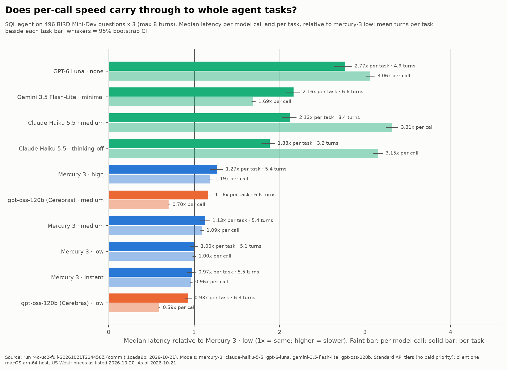
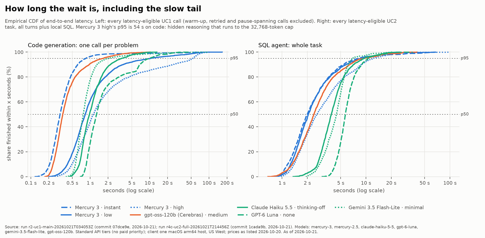
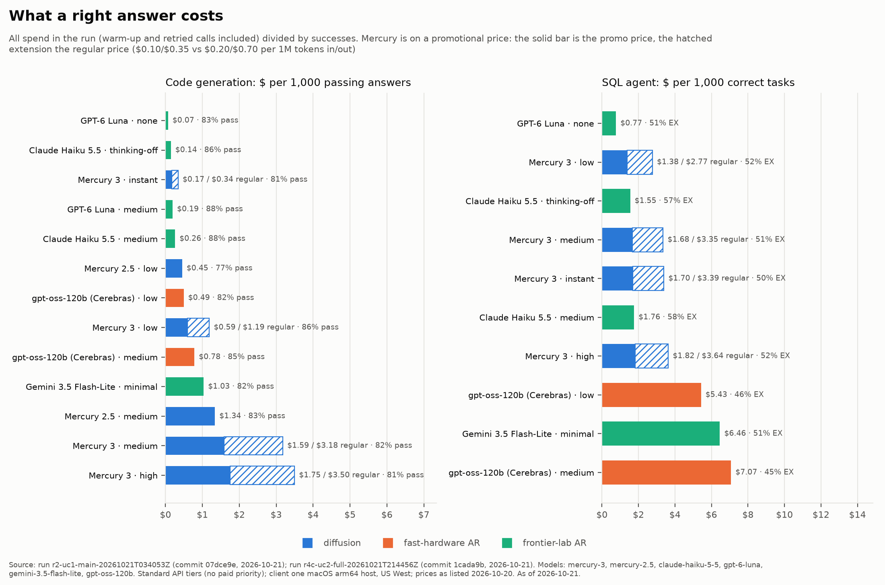
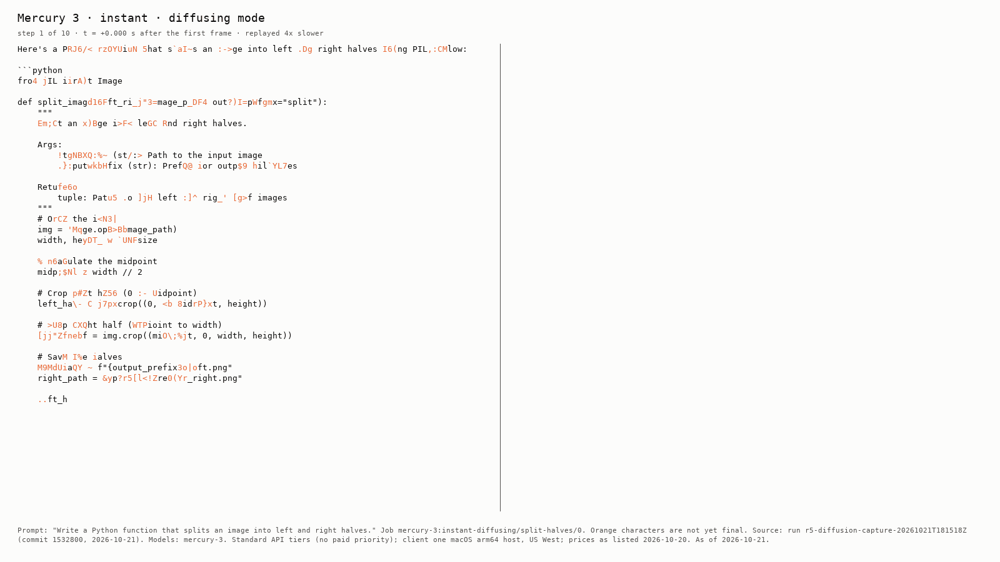

# Blog assets: Mercury 3 vs autoregressive LLMs

Generated by `uv run dllm-eval report` from the runs below (configs/report.yaml). Every
figure has its data next to it as a CSV and an "as of" footnote. Don't edit generated files by
hand: fix the analysis code or `reports/failure_tags.csv` and regenerate. The asset list is
BLOG_ALIGNMENT §5; findings and caveats are in docs/M4_ANALYSIS_RESULTS.md.

| Role | Run id | Commit | Date |
| --- | --- | --- | --- |
| uc1 | `r2-uc1-main-20261021T034053Z` | `07dce9e` | 2026-10-21 |
| uc1_length | `r3-uc1-length-20261021T152238Z` | `b9d80e6` | 2026-10-21 |
| uc2 | `r4-uc2-main-20261021T165313Z` | `91c7204` | 2026-10-21 |
| uc2_strict | `r4b-uc2-strict-20261021T170547Z` | `3c4b5fc` | 2026-10-21 |
| diffusion | `r5-diffusion-capture-20261021T181518Z` |  |  |

## Figure 1: speed vs. correctness on code generation (C1, C3)

Data: [fig1_pareto_uc1.csv](assets/fig1_pareto_uc1.csv).

## Figure 2: per-call vs. per-task speed in the SQL agent (C4)

Data: [fig2_task_vs_call_speedup_uc2.csv](assets/fig2_task_vs_call_speedup_uc2.csv).

## Figure 3: latency distributions (C1)

Data: [fig3_latency_cdf.csv](assets/fig3_latency_cdf.csv) (quantiles at 1% steps).

## Figure 4: cost per success, promo and regular Mercury prices

Data: [fig4_cost_per_success.csv](assets/fig4_cost_per_success.csv).

## Diffusion replay (C2)

Denoising dynamics per call (F7.2): [diffusion_dynamics.csv](assets/diffusion_dynamics.csv).

## Tables

- [table_reliability.md](table_reliability.md): tool-call validity, strict-schema adherence,
  runaway generation (C5)
- [failure_modes.md](failure_modes.md): failure tags per model (F6.6)
- [failure_gallery.md](failure_gallery.md): annotated examples (C6, C11)
- [decision_matrix.md](decision_matrix.md): when to pick a dLLM (C10)

*Report as of 2026-10-21; client one macOS arm64 host, US West; Standard API tiers (no paid priority).*
